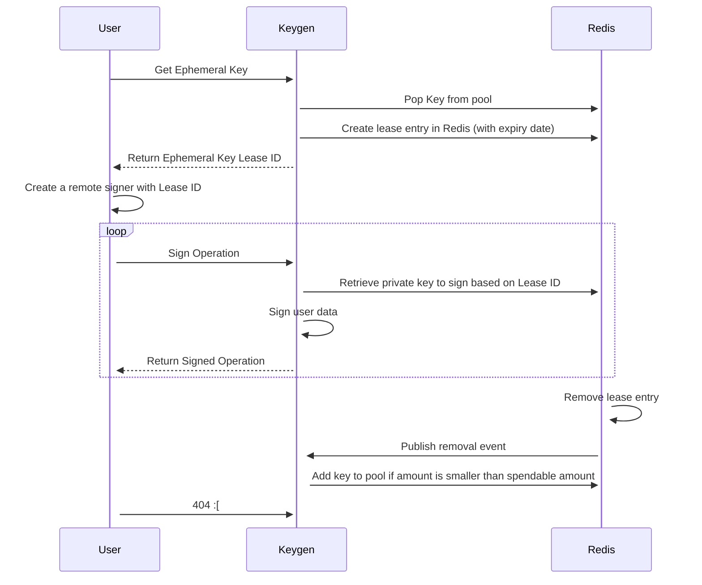

# octez.js Integration Tests

The `integration-tests` directory contains the integration test suite for octez.js. These tests are executed against live Tezos testnets (and a local Octez Docker sandbox for `tz5` tests), ensuring a comprehensive evaluation of various octez.js use cases.

Internally octez.js is tested with tests running in parallel. This is achieved using an application (a "keygen") that generates new keys and funds them as needed per test.
The application is not publicly available. External users, therefore, must run the octez.js Integration Tests in sequence, one test at a time.

For how the suite, the fresh-key acquisition, the prefetch buffer, the keygen service and the CI topology fit together, see [KEYGEN.md](./KEYGEN.md).

## Running Integration Tests Against a Tezos Testnet

To run tests in this environment, make sure you have:

- octez.js source code cloned to your local machine
- A compatible version of Node.js installed (see the top-level [`README.md`](../README.md))
- Successfully built octez.js (`npm ci && npm run build` from the root)

### Running all tests against all pre-configured testnets

From the `integration-tests` directory (or via `npm -w integration-tests` from the root), run:

```bash
npm run test # This runs all tests against all pre-configured testnets
```

### Running all tests against a specific testnet

Depending on the current Tezos upgrade cycle, multiple testnet networks may be configured in [`config.ts`](./config.ts). To target a specific testnet, use the corresponding script or environment variable:

```bash
USHUAIANET=true npm run test
```

## Configuration

Refer to [`config.ts`](./config.ts) for details on test configurations and target networks. Default values can be overridden using environment variables.

### Common CI Reliability Variables

- `OCTEZJS_KEYGEN_URL`: overrides the Keygen API base URL (default: `http://localhost:3000`, i.e. a keygen you run yourself — see `trilitech/octez.js-keygen`, whose image is `ghcr.io/trilitech/octezjs-keygen`)
- `OCTEZJS_KEYGEN_REQUEST_TIMEOUT_MS`: fail-fast timeout (in ms) for Keygen API HTTP requests (default: `30000`)
- `OCTEZJS_FRESH_KEY_MAX_ATTEMPTS`: max attempts when selecting a fresh key (default: `5`)
- `OCTEZJS_FRESH_KEY_RETRY_MS`: delay between fresh-key retry attempts in ms (default: `1000`)
- `OCTEZJS_ITEST_DIAGNOSTICS=true`: enables structured setup/key selection diagnostics in test logs


Fresh-key selection retries HTTP 500, 502, 503 and 504 while selection attempts remain.
A failed consumed prefetch entry uses the same retry policy. Other HTTP errors
and invalid successful responses still fail immediately. The configured delay
applies before the next selection attempt. Prefetch can start background requests
before that delay, so the selection budget does not cap all network requests.

This retry policy applies only to fresh-key acquisition. Invalid signer keys
still fail immediately. Signer-state RPC errors keep their existing behavior:
failed balance reads produce a null balance. With no minimum balance, selection
can succeed. With a positive minimum balance, an unavailable balance fails the
constraint and consumes a selection attempt.

### Check fresh-key setup locally

Run the controlled setup checks from the `integration-tests` directory:

```sh
npx vitest run __tests__/fresh-key-setup.spec.ts
```

The checks use local HTTP key-service and RPC fixtures. They do not request real
keys or send operations to a Tezos network. They cover transient retry and the
existing error and key-selection behavior. They do not verify recovery from a
real key-service outage.


## CLI Options

You can run a single test file against a configured testnet:

```bash
npm run test:ushuaianet contract-with-bigmap-init.spec.ts
```

Or run a specific test by name within a test file:

```bash
npm run test:ushuaianet -- -t "Verify contract.originate for a contract and call deposit method with unit param"
```


## Running Tests Against a Specific RPC URL

To run tests against a node that is not pre-configured in octez.js, export `TEZOS_RPC_<NETWORK>`:

```bash
export TEZOS_RPC_USHUAIANET='http://localhost:8732'
```

## Using a Secret Key Instead of the Keygen API


By default, the integration tests use an ephemeral key managed by the Keygen API, which requires internal access (for detail on Keygen see the below). However, to use a secret key of your own instead, use the CLI option `<testnet>-secret-key`, like this:


```
npm run test:ushuaianet-secret-key contract-with-bigmap-init.spec.ts
```


You can set your secret key (and password), or the `defaultSecretKey` from `config.ts` will be used:


```
export SECRET_KEY='edsk...'
```


If running the test with a configured secret key, ensure that the account balance is not zero.


## Local Octez Sandbox Tests (`tz5`)

The `tz5` (ML-DSA-44) conformance tests run against an isolated local Octez sandbox in Docker, not
against a testnet, so they need no keygen service or funded account. Run them from the repository
root:

```bash
npm run test:tz5:local
```

See [`tz5/README.md`](./tz5/README.md) for the pinned Octez image and what the suite covers.

## Test Report


Vitest prints the test summary directly in the terminal. Coverage artifacts are written under the integration test coverage output directory when coverage is enabled.


## The Keygen API

The Keygen API in octez.js is specifically designed for testing purposes. It allows developers to generate and manage key pairs (public and private keys) for Tezos accounts during the testing phase of their applications. This is useful for simulating various scenarios, such as transactions, smart contract interactions, and other on-chain operations, without the need to use real Tezos accounts or real funds.

This tool is employed internally for octez.js Integration tests within the Continuous Integration and Continuous Delivery (CI/CD) system.

### How the Keygen API works


